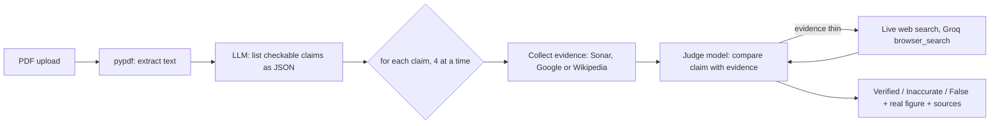

# Fact-Check Agent

Upload a PDF and the app checks every number, date and named fact in it against the live web. Each claim comes back as **Verified**, **Inaccurate** (wrong or out of date) or **False** (contradicted, or nothing supports it), with the correct figure and the links it was checked against.

Live app: https://fact-check-agent-ecru.vercel.app

Built for the "Fact-Check Agent" assignment (Part 2). Author: Shubham Kumar.

## Try it

1. Open the live app.
2. Drop in a PDF, or download the sample trap PDF from the page and use that.
3. Press **Check facts**. Claims show up first, then fill in one by one as they are checked (about 30 to 60 seconds for 15 claims).
4. Click the counters to filter, and download the results as CSV or JSON.

`samples/sample_trap.pdf` is a fake marketing brief with nine planted errors (wrong ChatGPT launch year, 2011 census population for India, 2019 US GDP, Bill Gates as Amazon's founder, Larry Page as Google's CEO and so on) mixed with four true facts. The script that builds it lists every planted error, so you can compare against what the app reports.

## How it works



- **Extract.** `pypdf` pulls the text. A model reads it and returns up to 20 atomic claims: stats, money, dates, people in roles, technical figures. Each claim is rewritten to stand on its own and comes with a neutral search query that leaves out the document's own number, so the search finds the real figure instead of pages repeating the wrong one.
- **Evidence.** The app uses the best source it has: Perplexity Sonar through Vercel AI Gateway if that is set up, Google results through SerpAPI if a key is set, and Wikipedia otherwise (no key needed). From Wikipedia it pulls the three closest articles and keeps the sentences that best match the claim, favouring ones with numbers and recent years.
- **Judge.** A separate model gets the claim and the evidence and decides the verdict under strict rules: an old figure that has since changed is Inaccurate, a made-up or contradicted one is False, and it may only use numbers and links that appear in the evidence. Links it returns are checked against the real search results so invented URLs never reach the page.
- **Second look.** If the judge says the evidence does not settle the claim, the app runs a live web search with Groq's `browser_search` tool (it opens real pages, for example Tesla's investor release for 2023 deliveries) and judges again with both sets of evidence.
- **Report.** The browser calls `/api/verify` once per claim, four in parallel, so each request stays short and inside Vercel's function time limit no matter how long the PDF is.

Search and judging are split on purpose. Search models are good at finding pages but go easy on a claim when asked for a verdict. A second model with a narrow job is stricter.

### Models

Two providers are supported and the app picks whichever is configured, gateway first:

| Provider | Extract | Judge | Search |
| --- | --- | --- | --- |
| Vercel AI Gateway | GPT-4.1 mini | GPT-4.1 | Perplexity Sonar |
| Groq | gpt-oss-120b | gpt-oss-120b | gpt-oss-20b with browser_search |

If the gateway refuses a request (no credits, bad auth) it is skipped for five minutes and Groq takes over. Groq's free tier allows about 8k tokens a minute per model, so each task has backup models (Qwen 3.8, gpt-oss-20b) that are tried when the first one is rate limited.

## Project layout

```
app.py                 FastAPI app: page, /api/extract, /api/verify, /api/health
factcheck/pdf_text.py  PDF to text
factcheck/llm.py       model calls for Vercel AI Gateway and Groq, with rate limit handling
factcheck/checker.py   prompts, claim extraction, search + judge per claim
factcheck/search.py    backup search: SerpAPI (Google) and Wikipedia
static/index.html      the whole frontend, plain HTML/CSS/JS
samples/               trap PDF and the script that generates it
```

## Run locally

```bash
python -m venv .venv && source .venv/bin/activate
pip install -r requirements.txt uvicorn
export GROQ_API_KEY=...         # free at console.groq.com/keys
# or: export AI_GATEWAY_API_KEY=...  (vercel.com > AI Gateway > API keys)
uvicorn app:app --reload
```

Then open http://localhost:8000.

## Environment variables

You need at least one of the first two.

| Name | What it does |
| --- | --- |
| `GROQ_API_KEY` | Groq key. Enables the Groq models and the live web search step. |
| `AI_GATEWAY_API_KEY` | Vercel AI Gateway key for local runs. On Vercel the deployment's OIDC token is used instead. |
| `SERPAPI_API_KEY` | Optional. Google results as an evidence source before Wikipedia. |
| `DISABLE_GATEWAY` | Set to `1` to skip the gateway completely. |
| `EXTRACT_MODEL` / `JUDGE_MODEL` / `SEARCH_MODEL` | Override the gateway models. |
| `MAX_CLAIMS` | Claims checked per PDF, default 20. |

## Deployment

The repo is linked to a Vercel project. Vercel detects FastAPI from `app.py` and `requirements.txt`, so there is no `vercel.json`. Every push to `main` deploys to production. AI Gateway calls use the OIDC token Vercel passes to each function. `GROQ_API_KEY` is stored as a sensitive environment variable on the project.

## Limits

- Text PDFs only. Scanned PDFs need OCR, which is not included.
- Up to 20 claims and 4 MB per file (Vercel's request size limit is 4.5 MB).
- Verdicts are only as good as what the search finds. Very new numbers (last few days) or paywalled data can come back as False with low confidence. The confidence score and the search notes under each claim show how solid a verdict is.
- Wikipedia is good for founders, dates and populations but can lag on very recent numbers. The live web search step covers that, but it only runs when the judge asks for it, to stay inside Groq's free rate limits.
- On Groq's free tier a 15 claim PDF takes about 45 to 90 seconds. Several people checking at once will slow it down further. The demo video shows a full run in case the API limits are hit during review.
- No accounts and nothing is stored. Each check runs fresh.
