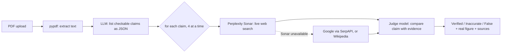

# Fact-Check Agent

Upload a PDF and the app checks every number, date and named fact in it against the live web. Each claim comes back as **Verified**, **Inaccurate** (wrong or out of date) or **False** (contradicted, or nothing supports it), with the correct figure and the links it was checked against.

Live app: https://fact-check-agent-ecru.vercel.app

Built for the "Fact-Check Agent" assignment (Part 2). Author: Shubham Kumar.

## Try it

1. Open the live app.
2. Drop in a PDF, or download the sample trap PDF from the page and use that.
3. Press **Check facts**. Claims show up first, then fill in one by one as they are checked (about 30 to 60 seconds for 15 claims).
4. Click the counters to filter, and download the results as CSV or JSON.

`samples/sample_trap.pdf` is a fake marketing brief with nine planted errors (wrong ChatGPT launch year, 2011 census population for India, 2019 US GDP, Bill Gates as Amazon's founder, Larry Page as Google's CEO and so on) mixed with four true facts. The script that builds it lists every planted error, so you can compare against what the app reports.

## How it works



- **Extract.** `pypdf` pulls the text. GPT-4.1 mini reads it and returns up to 20 atomic claims: stats, money, dates, people in roles, technical figures. Each claim is rewritten to stand on its own ("it grew 40%" becomes "Acme's revenue grew 40% in 2024") and comes with a search query.
- **Search.** Perplexity Sonar searches the web for each claim and writes up what current sources say, with links. The prompt includes today's date and asks for the latest figure and whether the claim's number was ever true, which is how outdated stats get caught.
- **Judge.** A separate model (GPT-4.1) gets the claim and the search notes and decides the verdict under strict rules: an old figure that has since changed is Inaccurate, a made-up or contradicted one is False, and it may only use numbers and links that appear in the search results. Links it returns are checked against the real search results so invented URLs never reach the page.
- **Report.** The browser calls `/api/verify` once per claim, four in parallel, so every request stays short and well inside Vercel's function time limit no matter how long the PDF is.

Search and judging are split on purpose. Search models are good at finding pages but tend to go easy on a claim when asked for a verdict. A second model with a narrow job is stricter.

## Project layout

```
app.py                 FastAPI app: page, /api/extract, /api/verify, /api/health
factcheck/pdf_text.py  PDF to text
factcheck/llm.py       OpenAI-compatible client for Vercel AI Gateway, with a fallback endpoint
factcheck/checker.py   prompts, claim extraction, search + judge per claim
factcheck/search.py    backup search: SerpAPI (Google) and Wikipedia
static/index.html      the whole frontend, plain HTML/CSS/JS
samples/               trap PDF and the script that generates it
```

## Run locally

```bash
python -m venv .venv && source .venv/bin/activate
pip install -r requirements.txt uvicorn
export AI_GATEWAY_API_KEY=...   # from vercel.com > AI Gateway > API keys
uvicorn app:app --reload
```

Then open http://localhost:8000.

## Environment variables

| Name | Needed | What it does |
| --- | --- | --- |
| `AI_GATEWAY_API_KEY` | locally | Key for Vercel AI Gateway. Not needed on Vercel, where the deployment's OIDC token is used. |
| `SERPAPI_API_KEY` | no | Enables Google results as backup search. |
| `SEARCH_BACKEND` | no | `sonar` (default) or `serpapi` to always use Google results. |
| `EXTRACT_MODEL` / `SEARCH_MODEL` / `JUDGE_MODEL` | no | Override models. Defaults: `openai/gpt-4.1-mini`, `perplexity/sonar`, `openai/gpt-4.1`. |
| `MAX_CLAIMS` | no | Claims checked per PDF, default 20. |
| `LLM_BASE_URL` / `LLM_API_KEY` | no | Point at any other OpenAI-compatible API instead of the gateway. |
| `FALLBACK_LLM_BASE_URL` / `FALLBACK_LLM_API_KEY` / `FALLBACK_LLM_MODEL` | no | Backup OpenAI-compatible model, used if the gateway refuses a request (for example no credits). |

## Deployment

The repo is linked to a Vercel project. Vercel detects FastAPI from `app.py` and `requirements.txt`, so there is no `vercel.json`. Every push to `main` deploys to production. AI Gateway calls are authenticated with the OIDC token Vercel passes to each function, so no provider keys are stored in the project.

## Limits

- Text PDFs only. Scanned PDFs need OCR, which is not included.
- Up to 20 claims and 4 MB per file (Vercel's request size limit is 4.5 MB).
- Verdicts are only as good as what the search finds. Very new numbers (last few days) or paywalled data can come back as False with low confidence. The confidence score and the search notes under each claim show how solid a verdict is.
- If Sonar fails, search falls back to Google (SerpAPI, if a key is set) and then Wikipedia. Wikipedia is fine for founders, dates and populations but weak on very recent numbers.
- If gateway credits run out, checks fail with a clear message unless a backup model is configured. The demo video shows a full run in case that happens during review.
- No accounts and nothing is stored. Each check runs fresh.
